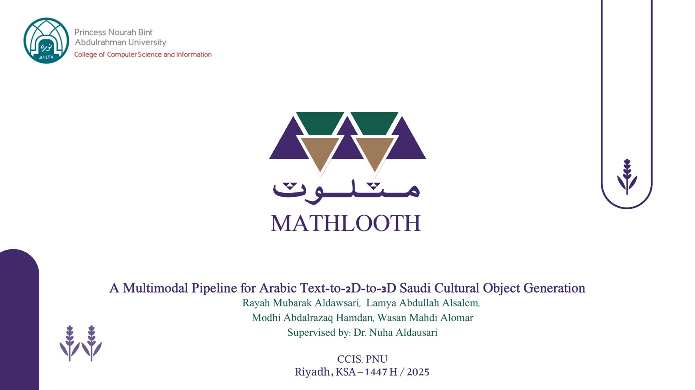
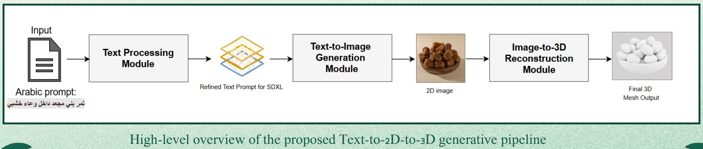
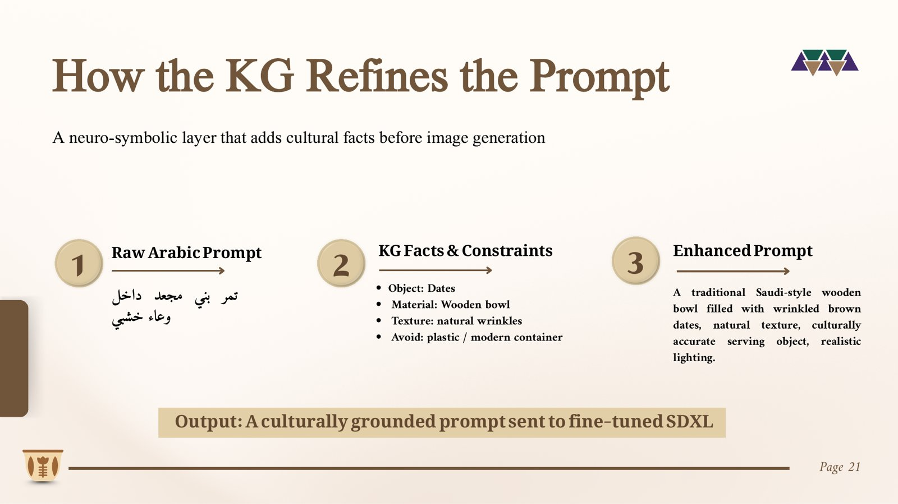
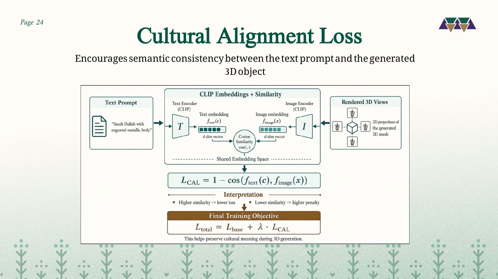
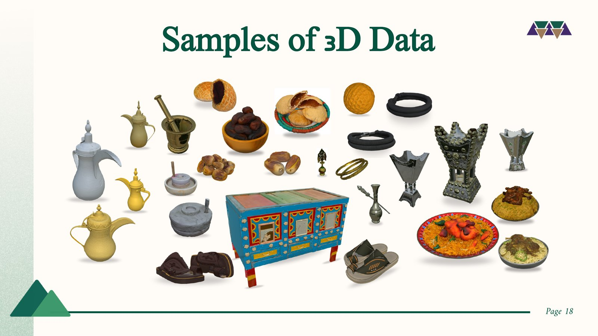
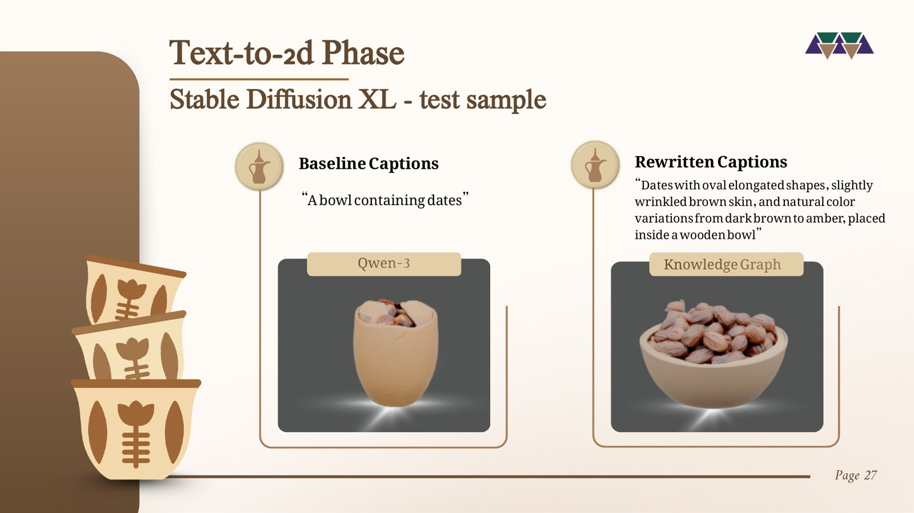
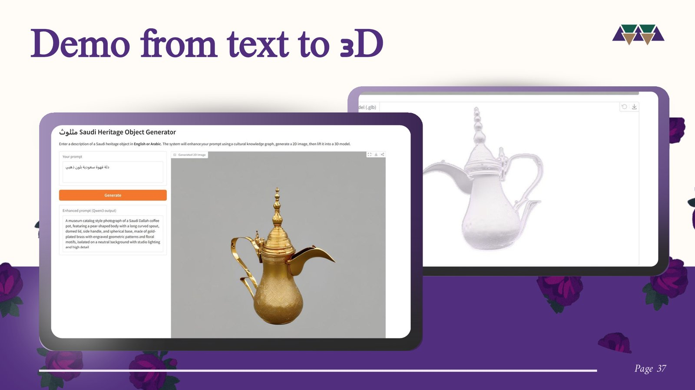
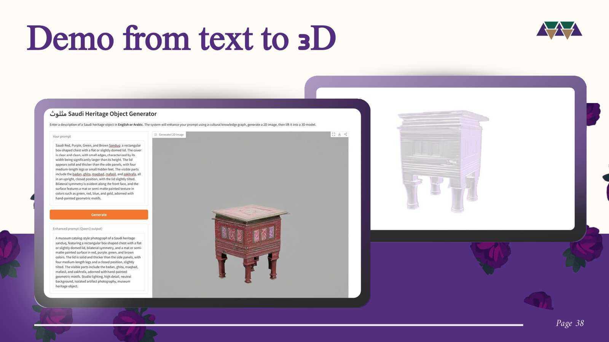
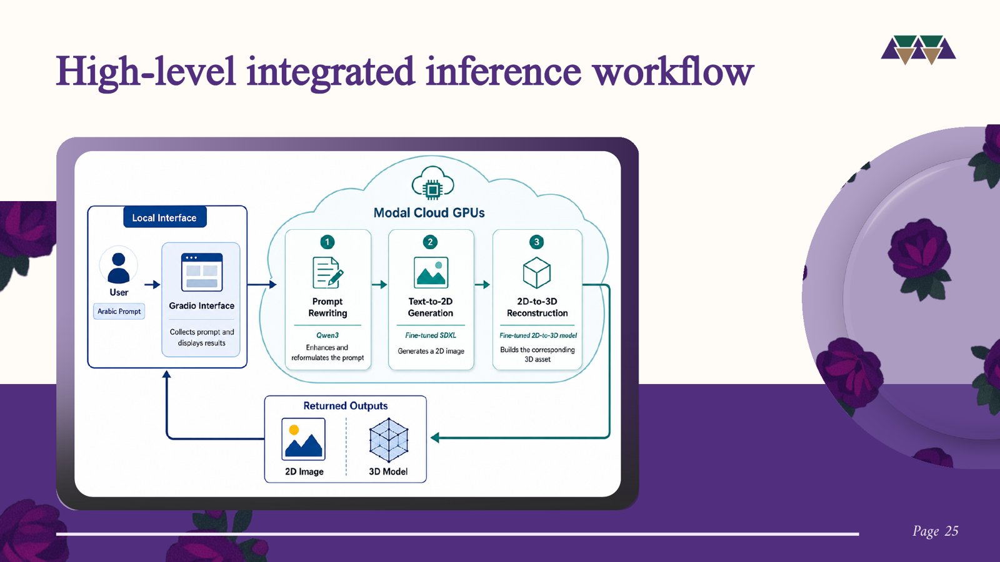

<div align="center">

# Mathlooth · مثلوث
### A Multimodal Pipeline for Arabic Text-to-2D-to-3D Saudi Cultural Object Generation
### من عمق التراث... إلى آفاق المستقبل


🎓 **Graduation Project** · College of Computer and Information Sciences, Princess Nourah bint Abdulrahman University · 2025 – 2026

🎓 **مشروع تخرج** · كلية علوم الحاسب والمعلومات، جامعة الأميرة نورة بنت عبدالرحمن

🏆 **3rd Place**, Bachelor's Graduation Projects, College of Computer and Information Sciences, PNU

🏆 **المركز الثالث** في مشاريع تخرج البكالوريوس، كلية علوم الحاسب والمعلومات، جامعة الأميرة نورة

[English](#english) · [العربية](#arabic)



</div>

---

<a id="english"></a>

## Overview

Ask today's leading generative AI models for a Saudi *dallah*, a *mabkhara* or a traditional *sanduq*, and they get it wrong. They are trained on Western-centric data, do not understand Arabic well, and lose the shapes, motifs and materials that make Saudi heritage objects what they are.

**Mathlooth** solves this. It is a first-of-its-kind generative AI system dedicated to Saudi cultural heritage: a user describes an object **in Arabic or English**, and the system produces a culturally accurate **2D image** and a matching **3D model** ready for digital museums, education, games and virtual exhibitions.

The project directly supports **Saudi Vision 2030** goals in preserving and digitizing national heritage.

## Key Highlights

- 🏆 **Award-winning**: won **3rd place** among Bachelor's graduation projects at the College of Computer and Information Sciences, Princess Nourah bint Abdulrahman University.
- 🤝 **In collaboration with the Saudi Heritage Commission**: the Commission provided part of the project's data, and Mathlooth took part in the Commission's **Digital Heritage Exhibition**.
- 🏺 **Built for Saudi heritage**: to our knowledge, the first Arabic text-to-2D-to-3D generation pipeline dedicated to Saudi cultural objects. Leading commercial tools (Luma Genie, Meshy AI, Scenario) are English-first and offer no Saudi cultural grounding.
- 🗂️ **Our own dataset, built from scratch**: no existing dataset contained Saudi heritage objects with paired text, images and 3D models, so we collected, described, cleaned and aligned one ourselves, then expanded it **from ~300 to ~5,000 multimodal samples** through augmentation.
- 🧠 **Saudi Heritage Knowledge Graph**: a neuro-symbolic layer storing each object's materials, form, functional parts, ornaments and cultural context, used to enrich the user's prompt with accurate cultural facts before generation.
- 🧩 **Novel Cultural Alignment Loss (CAL)**: a new training objective we introduced that keeps the generated 3D object semantically consistent with the cultural description.
- 🔬 **Rigorous evaluation**: quantitative metrics (FID, KID, CLIP, Long-CLIP, Chamfer Distance), cross-model validation on Hunyuan3D, and a user-based study.
- ☁️ **End-to-end working system**: deployed on Modal cloud GPUs with an interactive Gradio interface that takes an Arabic prompt and returns both the image and a downloadable 3D model.

## How It Works



| Stage | Model | What it does |
|---|---|---|
| **1. Prompt rewriting** | Qwen3-8B + Knowledge Graph | Normalizes and translates the Arabic prompt, looks up the object in the knowledge graph, and rewrites it into a precise, culturally grounded visual prompt plus a negative prompt |
| **2. Text-to-2D** | Stable Diffusion XL + fine-tuned LoRA | Generates a museum-catalog style image of the heritage object |
| **3. 2D-to-3D** | TripoSG + LoRA fine-tuned with CAL | Removes the background and reconstructs a 3D mesh (`.glb`) |

### The knowledge graph in action



### Cultural Alignment Loss



## The Dataset

Existing datasets lacked Saudi heritage objects, their cultural meaning, and paired text, 2D and 3D data for the same item. Part of the source data was provided by the **Saudi Heritage Commission**. We built our own in three phases: **2D image acquisition**, **description generation** (baseline and knowledge-graph-rewritten captions, verified by human quality checks), and **3D object generation**. The dataset covers categories such as coffee and serving tools, incense burners, furniture, traditional dress and footwear, jewelry and traditional food.



## Results

### Text-to-2D: knowledge-graph rewritten captions vs. baseline captions (fine-tuned SDXL)



| Metric | Baseline captions | Rewritten captions | Change |
|---|---|---|---|
| FID ↓ | 223.31 | **174.86** | 22% better |
| KID ↓ | 0.0798 | **0.0264** | 67% better |
| CLIP ↑ | 0.2605 | **0.2627** | ↑ |
| Long-CLIP ↑ | 0.2606 | **0.2737** | ↑ |

### 2D-to-3D: effect of the Cultural Alignment Loss

| Model | Chamfer Distance ↓ | CLIP Score ↑ |
|---|---|---|
| Fine-tuned TripoSG without CAL | **0.1972** | 0.8165 |
| Fine-tuned TripoSG with CAL | 0.2126 | **0.8309** |
| Fine-tuned Hunyuan3D without CAL | 0.1714 | 0.2296 |
| Fine-tuned Hunyuan3D with CAL | **0.1668** | **0.2311** |

CAL consistently improved semantic alignment (CLIP) on both 3D models, and on Hunyuan3D it improved geometric accuracy as well, confirming that the loss generalizes across architectures.

## Demo

| Prompt: «دلة قهوة سعودية بلون ذهبي» | Traditional *sanduq* |
|---|---|
|  |  |

## System Architecture



## Repository Structure

```
├── src/
│   └── mathlooth_pipeline.py      # full inference pipeline (KG + Qwen3 → SDXL → TripoSG) on Modal
├── docs/
│   └── mathlooth_presentation.pdf # project presentation
├── assets/                        # figures, results and demo screenshots
├── requirements.txt
└── README.md
```

## Running the Pipeline

```bash
pip install modal
modal setup
modal run src/mathlooth_pipeline.py --prompt "دلة قهوة سعودية بلون ذهبي"
```

The trained LoRA weights and the knowledge graph are not included in this repository. The pipeline expects them in a local `models/` folder (see the header of `src/mathlooth_pipeline.py`).

## Future Work

- Texture refinement for materials, colors and decorative details
- Expert validation with Saudi heritage specialists
- Multi-view reconstruction for higher 3D quality
- A culturally aware Arabic vision-language evaluation model
- Layered cultural alignment at global, object and attribute levels
- Dataset expansion to more Saudi regions and heritage categories

## Team

Rayah Mubarak Aldawsari · Lamya Abdullah Alsalem · Modhi Abdalrazaq Hamdan · **Wasan Mahdi Alomar**

Supervised by **Dr. Nuha Aldausari**

📄 Full details in the [project presentation](docs/mathlooth_presentation.pdf).

---

<a id="arabic"></a>
<div dir="rtl">

## نظرة عامة

اطلب اليوم من أشهر نماذج الذكاء الاصطناعي التوليدي أن ترسم لك دلّة سعودية أو مبخرة أو صندوقاً تراثياً، وستجدها تخطئ في الشكل والتفاصيل. فهذه النماذج مدرّبة على بيانات غربية في معظمها، وفهمها للغة العربية محدود، وتضيع منها الأشكال والزخارف والخامات التي تميّز التراث السعودي.

**مثلوث** جاء ليحل هذه المشكلة. هو نظام ذكاء اصطناعي توليدي فريد من نوعه، مخصص للتراث الثقافي السعودي: يصف المستخدم القطعة **بالعربية أو الإنجليزية**، فيولّد النظام **صورة ثنائية الأبعاد** دقيقة ثقافياً، ثم **نموذجاً ثلاثي الأبعاد** مطابقاً لها، جاهزاً للمتاحف الرقمية والتعليم والألعاب والمعارض الافتراضية.

ويدعم المشروع بشكل مباشر مستهدفات **رؤية المملكة 2030** في حفظ التراث الوطني ورقمنته.

## أبرز ما يميّز المشروع

- 🏆 **مشروع حائز على جائزة**: حصل على **المركز الثالث** في مشاريع تخرج البكالوريوس بكلية علوم الحاسب والمعلومات في جامعة الأميرة نورة بنت عبدالرحمن.
- 🤝 **بالشراكة مع هيئة التراث**: وفّرت الهيئة جزءاً من بيانات المشروع، وشارك مثلوث في **معرض التراث الرقمي** التابع للهيئة.
- 🏺 **مصمَّم للتراث السعودي**: بحسب علمنا، أول مسار توليد من النص العربي إلى صورة ثنائية الأبعاد ثم إلى نموذج ثلاثي الأبعاد مخصص للقطع التراثية السعودية، في حين أن الأدوات التجارية الرائدة تدعم الإنجليزية أساساً ولا تراعي الخصوصية الثقافية السعودية.
- 🗂️ **بيانات بنيناها من الصفر**: لم تكن هناك أي مجموعة بيانات تضم القطع التراثية السعودية مع نصوصها وصورها ونماذجها ثلاثية الأبعاد معاً، فجمعناها ووصفناها ونظّفناها وربطناها بأنفسنا، ثم وسّعناها **من نحو 300 إلى نحو 5,000 عينة متعددة الوسائط**.
- 🧠 **رسم معرفي للتراث السعودي**: طبقة تحفظ لكل قطعة خاماتها وشكلها وأجزاءها وزخارفها وسياقها الثقافي، وتُستخدم لإثراء وصف المستخدم بمعلومات ثقافية دقيقة قبل التوليد.
- 🧩 **دالة خسارة جديدة للمواءمة الثقافية (CAL)**: هدف تدريبي جديد قدّمناه يحافظ على اتساق النموذج ثلاثي الأبعاد مع الوصف الثقافي.
- 🔬 **تقييم شامل**: مقاييس كمية (FID و KID و CLIP و Long-CLIP و Chamfer Distance)، وتحقق على نموذج آخر هو Hunyuan3D، وتقييم من المستخدمين.
- ☁️ **نظام متكامل يعمل فعلياً**: منشور على وحدات معالجة رسومية سحابية عبر Modal، بواجهة تفاعلية تستقبل الوصف بالعربية وتعيد الصورة والنموذج ثلاثي الأبعاد قابلاً للتحميل.

## آلية العمل

1. **إعادة صياغة الوصف**: نموذج Qwen3-8B مع الرسم المعرفي يحوّل الوصف العربي إلى وصف بصري دقيق ومرتبط بالثقافة السعودية.
2. **من النص إلى صورة**: نموذج Stable Diffusion XL بعد تخصيصه على بياناتنا.
3. **من الصورة إلى نموذج ثلاثي الأبعاد**: نموذج TripoSG بعد تخصيصه باستخدام دالة المواءمة الثقافية.

## النتائج

- تحسّن مقياس **FID بنسبة 22%** ومقياس **KID بنسبة 67%** عند استخدام الأوصاف المُعاد صياغتها بالرسم المعرفي مقارنة بالأوصاف الأساسية.
- حسّنت **دالة المواءمة الثقافية** التوافق الدلالي (CLIP) في نموذجَي TripoSG و Hunyuan3D، وحسّنت الدقة الهندسية في Hunyuan3D كذلك.

## الفريق

Rayah Mubarak Aldawsari · Lamya Abdullah Alsalem · Modhi Abdalrazaq Hamdan · **Wasan Mahdi Alomar**

بإشراف **Dr. Nuha Aldausari**

📄 التفاصيل الكاملة في [العرض التقديمي للمشروع](docs/mathlooth_presentation.pdf).

</div>
